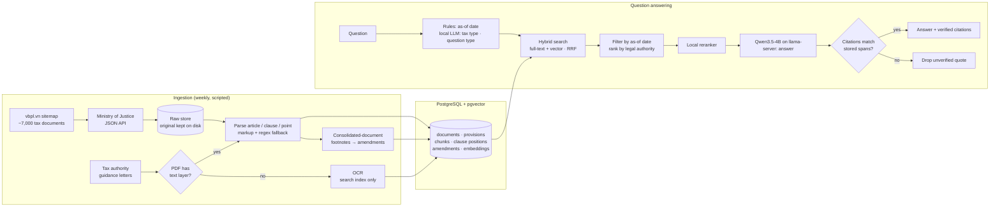

# TaxAssistant

**A citation-grounded RAG assistant for Vietnamese tax law** — every answer quotes the source law verbatim, knows whether that law is still in force, and can answer *as of a past date*.

> 🚧 **Status: in active development.** Discovery, data-source research and system design are complete; implementation is in progress. See [Roadmap](#roadmap).

Built for a real first user: a former accountant who advises household businesses and small companies in Ho Chi Minh City, and today looks things up by hand on government websites.

---

## Why this is hard

Answering tax questions with an LLM is easy. Answering them **correctly enough that a professional can rely on them** is not:

| Problem | Why generic RAG fails |
|---|---|
| **Hallucinated citations** | An LLM will confidently cite "Article 9, Clause 2" that doesn't say what it claims. In tax advice, a wrong citation is worse than no answer. |
| **Laws change over time** | A threshold changed from 500M to 1B VND on 01/01/2026. "What was the rule in 2025?" needs a *point-in-time* model, not just the latest text. |
| **Amendments are surgical** | One decree replaced the phrase *"500 triệu đồng"* at **18 places** across another decree. Versioning by article or clause is only an approximation. |
| **Clauses don't stand alone** | Point (a) of a penalty clause says *"filing 61–90 days late"* — the fine (8–15M VND) is in the clause's lead sentence. Naive chunking retrieves the offence without the penalty. |
| **Mixed legal authority** | Guidance letters (*công văn*) are heavily used but are **not** binding law. The system must rank and label them differently. |
| **Scanned documents** | Older guidance letters are image-only PDFs. OCR can misread *8,000,000* as *3,000,000* — unacceptable in a quoted penalty amount. |
| **Small hardware** | Everything runs on one laptop with a 6 GB GPU — the answer model is self-hosted, so the user's questions never leave the machine. |

---

## Key design decisions

### 1. Citations are verified, not generated
Each retrieved chunk stores a **position index** of every clause and point inside it. Before an answer is shown, every quoted passage is **matched against the stored text spans**. A quote that doesn't match any stored span is never displayed as a citation. The model cannot invent an article number.

### 2. Point-in-time legal model
The source API returns document-level validity but **no amendment graph** (verified: the relation fields are empty). Amendment history is instead reconstructed from the **footnotes of consolidated documents**, which state exactly what was amended — down to a single phrase — and from which date. Answers are always resolved against an *as-of date* (default: today).

### 3. Article-level chunking with an internal clause index
Chunking was decided from evidence, not convention:
- Vietnamese law (Law 64/2025, Art. 7) requires only **articles** to have titles — clauses and points are unlabelled fragments.
- Measured on a penalty decree: **≥12% of clauses/points** carry explicit back-references to their parent; the real share is higher.
- Every existing Vietnamese legal-retrieval system surveyed indexes at article level.

So each chunk is a **whole article**, while the clause index still allows precise citations like *"point a, clause 4, Article 13"*.

### 4. Hybrid retrieval inside PostgreSQL
Keyword search (Postgres full-text with an accent-insensitive Vietnamese setup) plus semantic search (**pgvector**), fused with reciprocal rank fusion. Results are filtered by the as-of date and ranked by legal authority: binding law before guidance letters. No separate vector database.

### 5. Small local models, deterministic where it matters
The answer model is **self-hosted on the laptop** (llama.cpp `llama-server`, Qwen3.5-4B 4-bit). The **as-of date is extracted by deterministic rules**, not by a model: anything that decides whether an answer is right must be extracted deterministically where possible. Tax type and question type are classified by the local LLM with JSON-schema-constrained output for now; results are logged with user feedback so a small fine-tuned local encoder (mmBERT-small or BamiBERT, with PhoBERT and embeddings + logistic regression as baselines) can replace it once there are enough labels. The point is a deterministic first stage: same question, same label, with a probability, so every wrong answer can be attributed to wrong extraction, wrong retrieval, wrong reasoning, or hallucination. The tax type only *boosts* results, never hard-filters them. Embeddings and reranking also run locally.

### 6. A workflow, not an agent
The pipeline is fixed in code; the model never decides to "search again". This was a deliberate choice: it keeps **per-question latency predictable** on a small GPU, guarantees the citation check always runs, and makes failures traceable to a specific stage.

### 7. Explicit responsibility boundary for legal judgement
For "is this a violation?" questions, the system answers in **conditional branches** — *if A, then provision X applies, penalty Y, remediation Z* — with every remediation step and deadline backed by its own citation. It **never asserts** that a real situation is a violation. The model is responsible for the legal basis; the professional is responsible for the facts.

### 8. OCR is for retrieval only
Text extracted from scanned PDFs is indexed so the document can be *found*, but is **never quoted**. For scanned sources the answer gives the document number and a link to the original. This is enforced at the schema level (`text_origin` column), not just in the prompt.

### 9. Measured, not assumed
Every model call logs tokens and latency; a performance page shows answer time and GPU memory. Claude is used only as an offline evaluation judge (so the answer model never grades itself), and its outputs are never used as training data — Anthropic's Usage Policy forbids model distillation without authorization.

---

## Architecture



---

## Data sources and compliance

Research found **no source in this domain with an explicit reuse licence**: government portals publish no terms of use, and the two major commercial legal databases explicitly prohibit automated collection. The project therefore uses **only publicly available data, collected without violating any published rule**.

| Source | Used for | Constraints respected |
|---|---|---|
| Ministry of Justice legal database (JSON API) | Full text, validity status, article structure | Raw copies kept; fallback source ready in case the undocumented API disappears |
| Official Gazette (congbao.chinhphu.vn) | Fallback text, new-document feed | Attribution required and given |
| General Department of Taxation (gdt.gov.vn) | ~6,000–11,000 guidance letters (estimated) | Attribution required and given; CAPTCHA-protected search is **not** used |
| thuvienphapluat.vn, luatvietnam.vn | **Not used** | Terms of service prohibit automated collection and AI training |

`robots.txt` is honoured per host, and all requests are rate-limited.

---

## Tech stack

| Layer | Choice |
|---|---|
| Language | Python 3.12 |
| API & web | FastAPI, server-rendered HTML (no frontend build step) |
| Database | PostgreSQL 18 · pgvector · unaccent · pg_trgm |
| Answer orchestration | LangGraph `StateGraph` with a Postgres checkpointer (multi-turn conversations, per-step state history, streaming, retries, timeouts) — fixed edges, no agent loop |
| LLM serving | llama.cpp `llama-server` (CUDA 12.4), OpenAI-compatible API · Qwen3.5-4B Q4_K_M (proposed, pending measurement) |
| Evaluation judge | Claude, offline eval runs only — never in the app, never as training data |
| Embeddings | Local model on NVIDIA RTX 3060 (6 GB) |
| Document processing | httpx · lxml · pypdf · OCR |
| Access (early stage) | Private VPN tunnel — nothing exposed to the public internet |

---

## Roadmap

- [x] Discovery: requirements, constraints and user journeys with the first user
- [x] Data-source research: licensing, API behaviour, document structure, coverage
- [x] System design: chunking, point-in-time model, citation verification
- [x] Database schema, migrations and self-check (Postgres 18 + pgvector 0.8.7)
- [x] Ingest tax legislation from the Ministry of Justice API — 2,865 documents, 12,353 articles, automated with Dagster
- [ ] **Self-hosted answer model on the laptop** (llama-server + Qwen3.5) — in progress
- [ ] Amendment history from consolidated-document footnotes
- [ ] Hybrid retrieval + embedding model selection, measured on real user questions
- [ ] Guidance-letter ingestion with PDF classification and OCR
- [ ] Answer generation with citation verification and latency/GPU monitoring
- [ ] Responsive web app for the first user
- [ ] Conditional violation assessment and "before vs after" comparisons
- [ ] Weekly automated updates and monitoring
- [ ] Improve the local model only where the eval shows a gap: SFT on the user's corrections, RL with the deterministic guardrails as verifiable rewards (GRPO), KTO/DPO from thumbs up/down
- [ ] Next phase: GPU VPS with vLLM / SGLang

**Evaluation plan:** a test set built from the first user's real questions, measuring article-level recall@5, the share of citations that match stored spans, and whether the system correctly says *"no legal basis found"* when the corpus doesn't cover a question.

---

## Getting started

Requires Python 3.12+ and PostgreSQL with the `pgvector` extension. The Windows PostgreSQL installer does not ship pgvector; build it with Visual Studio Build Tools (`nmake /F Makefile.win`, see the pgvector README) and copy the files into the PostgreSQL folder as administrator. Run `psql` in cmd or Windows Terminal, not Git Bash: psql on Windows reads passwords from the console.

```bash
python -m venv .venv
source .venv/bin/activate          # Windows: .venv\Scripts\activate
pip install -e .

# One-time, as the Postgres superuser: least-privilege app role + database + extensions
psql -U postgres -h 127.0.0.1 -f app/db/create_app_user.sql
cp .env.example .env               # then set PGUSER=taxassistant and its PGPASSWORD

python -m app.db.setup_database    # creates the database and schema
python -m app.db.check_database    # should print PASS

# Answer model (self-hosted): llama.cpp build + GGUF live outside the repo (default D:/models)
bash scripts/run_model_server.sh     # llama-server on 127.0.0.1:9931, OpenAI-compatible API + built-in chat UI

# Data pipeline (run in order)
pip install -e ".[pipeline]"
bash scripts/run_pipeline.sh         # whole pipeline once (Dagster); Git Bash on Windows or Linux
bash scripts/run_pipeline.sh ui      # web UI + weekly schedule (runs while open)

# Or one stage at a time
python -m app.ingest.download_moj_documents   # tax documents from the Ministry of Justice API
python -m app.ingest.download_from_congbao    # fallback source for documents the API lacks
python -m app.ingest.save_to_database         # split into articles/clauses/points and load
```

Each ingest module also has a network-free self-check: `python -m app.ingest.<module> --check`.

The self-check verifies that migrations are idempotent, that the full schema and extensions exist, that clause spans read back correctly, that accent-insensitive search matches *"hoa don"* to *"hóa đơn"*, and that the schema's integrity constraints actually reject bad data.

---

## Repository layout

```
app/
  config.py                              settings from .env, model pricing
  db/
    create_app_user.sql                  one-time superuser script: app role owning only its database
    setup_database.py                    create the database, apply SQL migrations
    check_database.py                    runnable integrity checks
    migrations/001_create_tables.sql     schema — each table documents why it exists
    migrations/002_track_raw_source_and_parser.sql   which raw file and parser version produced each document
  ingest/
    download_moj_documents.py            sitemap → Ministry of Justice JSON + attachments, raw copies on disk
    download_from_congbao.py             fallback: Official Gazette search for documents the API lacks
    split_articles.py                    HTML → articles / clauses / points with character spans
    save_to_database.py                  raw copies → documents, provisions, chunks, chunk_positions
    stage_report.py                      per-stage report: counts and per-document failures
  pipeline/
    definitions.py                       Dagster assets + data-quality checks wiring the ingest stages
dagster_home/dagster.yaml                Dagster config (run history and logs live here, not committed)
scripts/run_pipeline.sh                  run the pipeline once, or open Dagster (UI + weekly schedule)
scripts/run_model_server.sh              start llama-server with the answer model (flags documented inline)
CLAUDE.md                                entry point for AI coding agents: what to read, in what order
docs/                                    design documents (Vietnamese)
  project-overview.md          product, scope, success criteria
  architecture.md              stack, folder boundaries, storage, invariants, cost
  code-standards.md            coding conventions
  ai-workflow-rules.md         how an AI agent must work on this repo
  ui-context.md                UI constraints (mostly not decided yet)
  progress-tracker.md          current state, next steps, open questions
  ke-hoach.md                  build plan with "done when" criteria
  nguon-du-lieu.md             data-source research findings, fallback sources
  danh-gia.md                  guardrails and research-backed evaluation for every model stage
  thu-bac-van-ban.md           legal hierarchy, conflict rules, status of guidance letters (cited to the law)
  pipeline-du-lieu.md          what Dagster is, pipeline stages, checks, how to run and debug
  thuat-ngu.md                 domain glossary
```
