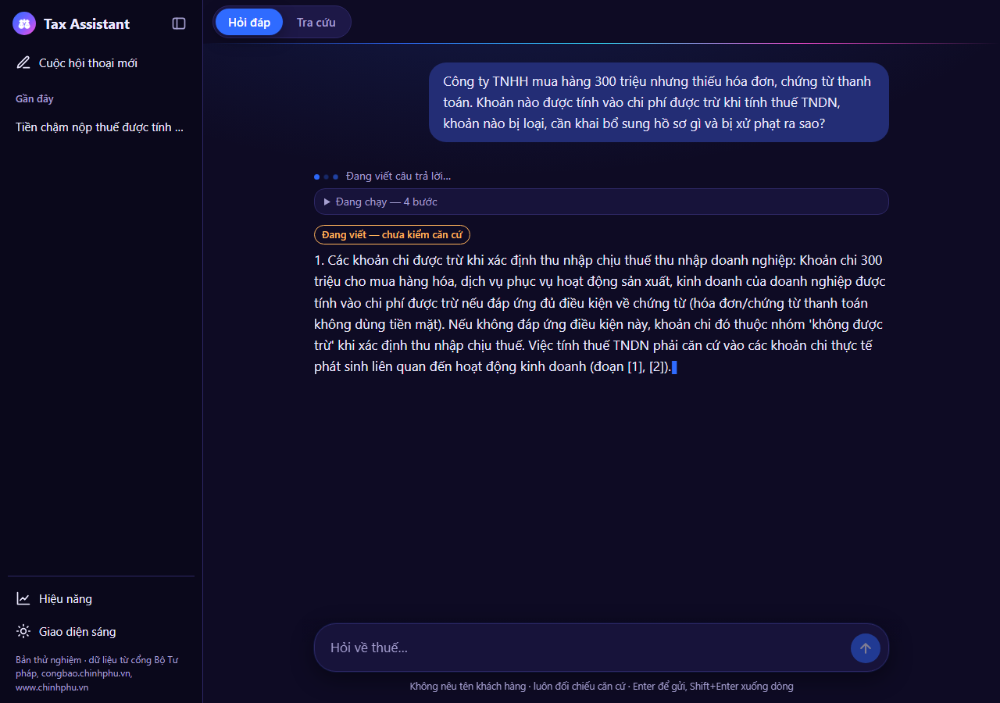
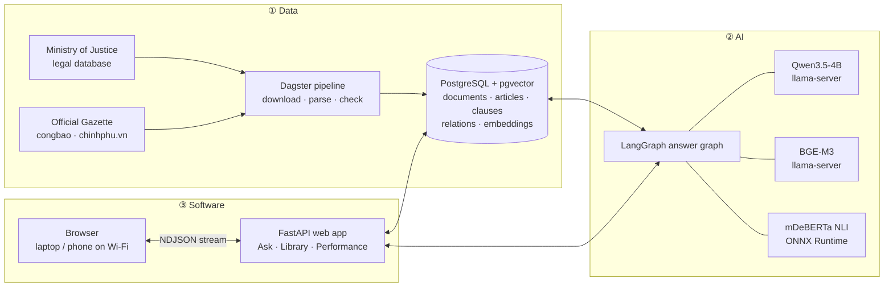
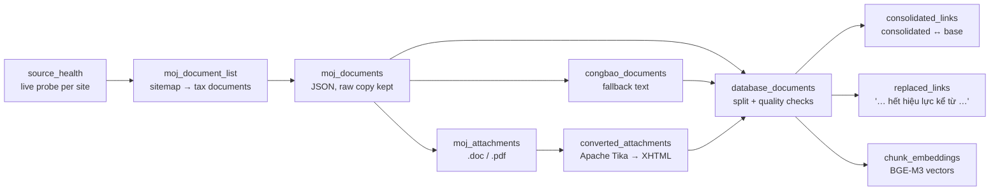
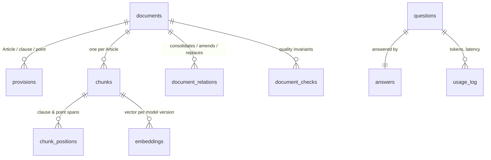
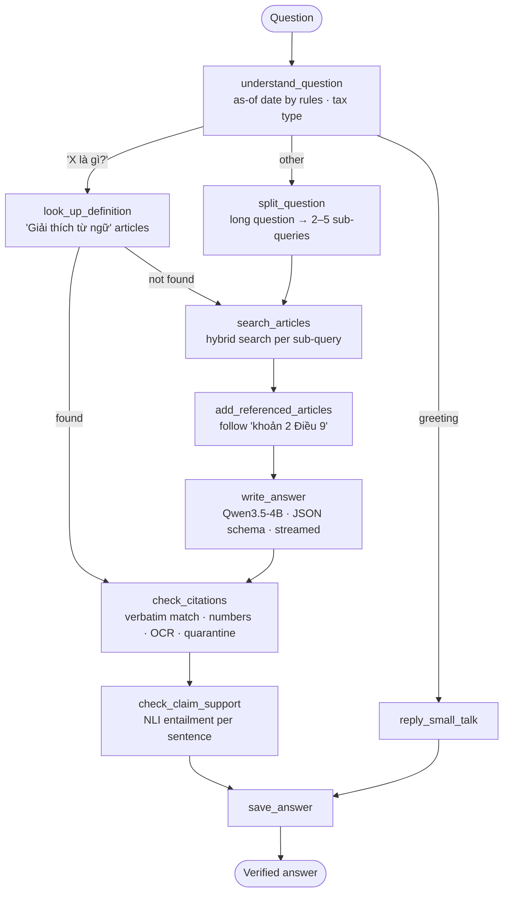
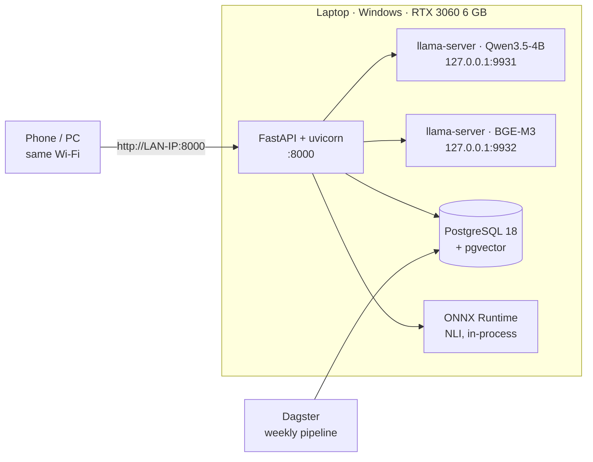

# TaxAssistant

**A self-hosted, citation-grounded RAG assistant for Vietnamese tax law.** Every answer quotes the law verbatim, every quote is verified against the stored text, and every answer is resolved *as of a date* — so the assistant knows which law was in force when.

Runs entirely on one laptop (RTX 3060, 6 GB): the answer model, embeddings and guardrails are local; questions never leave the machine. Built for a practising accountant who advises household businesses and small companies.

<p align="center">
  
  
</p>

---

## Contents

- [Highlights](#highlights)
- [System overview](#system-overview)
- [Data](#data) — sources, pipeline, quality layers, data model
- [AI](#ai) — retrieval, answer graph, models, guardrails, evaluation
- [Software](#software) — runtime architecture, web app, tech stack
- [Getting started](#getting-started)
- [Using it on the home network](#using-it-on-the-home-network)
- [Repository layout](#repository-layout)
- [Roadmap](#roadmap)
- [Documentation](#documentation)

---

## Highlights

| | |
|---|---|
| **Verified citations** | Quotes must match the stored article text character-for-character (whitespace aside). A quote that does not match is dropped, never shown. |
| **Point-in-time answers** | Each answer is resolved at an as-of date read deterministically from the question ("năm 2025", "1/7/2026", "hiện nay"). Laws repealed by a newer law are ranked last and labelled with the exact clause that repealed them. |
| **Hybrid retrieval** | PostgreSQL full-text + BGE-M3 vectors (pgvector), fused with reciprocal rank fusion, filtered by validity at the as-of date. |
| **Multi-part questions** | Long analytical questions are split into focused sub-queries; each is retrieved separately and answered point by point. |
| **Cross-references followed** | "theo khoản 2 Điều 9 Luật này" pulls in the referenced clause automatically. |
| **Guardrails** | Number check, entailment check (multilingual NLI), OCR text never quoted, quarantine for documents that fail data-quality invariants. |
| **Streaming UI** | Answers stream token by token, clearly marked *"not yet verified"* until the checks finish and the verified version replaces the draft. |
| **Fully local** | llama.cpp for generation and embeddings, ONNX Runtime for NLI. No external API at runtime. |

---

## System overview



---

## Data

### Sources and compliance

No source in this domain publishes an explicit reuse licence. The project only uses publicly available data, collected without violating any published rule: `robots.txt` is honoured per host, every request is rate-limited, CAPTCHA-protected search is never automated, and sources are attributed in the UI.

| Source | Used for |
|---|---|
| Ministry of Justice legal database (vbpl.vn, JSON API) | Full text, validity status, article markup, attachments |
| Official Gazette (congbao.chinhphu.vn), chinhphu.vn | Fallback text and discovery of new documents |
| Commercial legal databases | **Not used** — their terms prohibit automated collection |

### Pipeline

The pipeline is a set of [Dagster](https://dagster.io) assets with data-quality checks; it runs weekly and every stage reports per-document failures without stopping the run.



**Parsing.** HTML and converted attachments are split into *Article → clause → point* with character spans, so a citation can be labelled "point a, clause 4, Article 13". Documents without articles fall back to Roman-numbered sections, numbered sections, then fixed-length passages. Legacy TCVN3-encoded text is converted to Unicode; text from PDFs is marked as OCR and is searchable but never quoted.

**Relations rebuilt from the text.** The source API returns no amendment graph, so relations are reconstructed:
- *consolidated → base* and *amending → base*, from the preamble of consolidated documents;
- *replaced / repealed*, from effect articles such as *"Luật Quản lý thuế số 38/2019/QH14 … hết hiệu lực kể từ ngày Luật này có hiệu lực"* — about 150 relations, whose dates agree with the portal's own expiry dates in 96% of the cases where the portal has one.

### Four layers that keep the data clean

| Layer | What it does |
|---|---|
| 1. Standard tools for file formats | Apache Tika reads Word/RTF/PDF; no hand-written format parsers. |
| 2. Invariant checks + quarantine | Every document is checked for encoding, heading order, coverage and passage length. Documents failing a hard check are **quarantined**: searchable, never quoted, listed for manual review. |
| 3. Golden cases | Every real defect found becomes a fixed regression case run on the real document. |
| 4. Markup-learned structure | Where the portal provides article markup it is the ground truth for the splitter. |

### Data model



Current corpus: **2,865** tax documents · **85,753** articles/clauses/points · **16,878** searchable passages, all embedded · **107** consolidated documents.

---

## AI

### Answer graph

A fixed [LangGraph](https://langchain-ai.github.io/langgraph/) `StateGraph` — not an agent. Latency is predictable, the citation check always runs, and every failure is traceable to one step. A Postgres checkpointer keeps multi-turn conversations.



### Retrieval

1. **Keyword**: PostgreSQL full-text on accent-stripped text (`unaccent`), length-normalised rank plus a boost for matching article titles.
2. **Semantic**: BGE-M3 vectors with exact cosine search in pgvector, so filters never cause missed results.
3. **Fusion**: reciprocal rank fusion (k = 60), multiplied by legal authority (law and consolidated text above decrees, guidance letters last).
4. **Validity at the as-of date**: documents not yet in force or already expired are filtered out. Base laws are hidden when a consolidated version exists. Laws repealed by a newer law, and old documents with unreliable status, are ranked after everything else and labelled.
5. **Context**: each passage is embedded with its document type, number, title and article heading (contextual retrieval).

### Models

| Role | Model | Runtime | Licence |
|---|---|---|---|
| Answer generation, question splitting | Qwen3.5-4B, Q4_K_M | llama.cpp `llama-server`, GPU | Apache-2.0 |
| Embeddings | BGE-M3, f16 GGUF (self-converted from BAAI weights) | second `llama-server`, GPU | MIT |
| Entailment guardrail | mDeBERTa-v3-base-xnli-multilingual-nli-2mil7, ONNX float32 | ONNX Runtime, CPU | MIT |

### Guardrails

| | Check | On failure |
|---|---|---|
| a | Every quote matches the stored text verbatim | Quote dropped |
| b | Quote belongs to a passage retrieved for this question (a mis-numbered passage is re-attributed only if the text matches exactly one other passage) | Quote dropped |
| c | Every number in the conclusion appears in a verified quote (except numbers from the question, the as-of year and citation labels) | Number flagged |
| d | No passage retrieved → no model call | "No legal basis found" |
| e | OCR text is never quoted | Document number + link only |
| f | Quarantined documents are never quoted | Document number + link only |
| g | Each conclusion sentence is entailed by the cited clause (AlignScore-style, NLI) | Scored and logged; warnings hidden until the threshold is calibrated |

### Evaluation

Search, on a provisional set of 20 questions with labelled correct articles (`python -m app.answer.measure_search`):

| Method | recall@5 | MRR@10 | recall@20 |
|---|---|---|---|
| Keyword | 0.45 | 0.36 | 0.50 |
| Semantic (BGE-M3) | 0.90 | 0.84 | 0.90 |
| **Hybrid (RRF)** | **0.90** | 0.73 | 0.90 |

Because recall@5 equals recall@20, a reranker would not recover any missed article on this set, so none is used yet.

Other measurements:
- **Cross-references**: 98% of in-document references resolve to the target article.
- **NLI on ONNX float32**: scores identical to PyTorch on 51 real pairs. int8 quantisation was rejected because it flips pass/fail on 17–35 of 51 pairs.
- **Latency** on the laptop: about 7 s for a typical question (first streamed text after about 4–5 s); 60–90 s for a five-part analytical question.

The evaluation methodology, with sources for every metric, is in [`docs/danh-gia.md`](docs/danh-gia.md).

---

## Software

### Runtime



The model servers listen on `127.0.0.1` only. Just the web app is exposed to the local network.

### Web app

- **Ask** (*Hỏi đáp*): ChatGPT-style layout, conversation history, streamed answers, the steps of each answer in a collapsible block, copy button, verified citations linking to the exact article.
- **Library** (*Tra cứu*): browse and search documents by number, title and legal rank. Each document page shows its articles, validity labels, related documents (consolidated, amended, replaced) and the original file.
- **Performance** (*Hiệu năng*): questions asked, answer time by question type, GPU memory, model throughput.
- Light and dark themes (dark uses a synthwave palette). Works on phones. Plain HTML, CSS and JS rendered by Jinja2, with no frontend build step.

<p align="center"></p>

### Tech stack

| Layer | Choice |
|---|---|
| Language | Python 3.12 |
| Web | FastAPI, uvicorn, Jinja2; vanilla JS with NDJSON streaming |
| Orchestration | LangGraph 1.2 with Postgres checkpointer · Dagster 1.13 for data |
| Database | PostgreSQL 18 · pgvector 0.8 · unaccent |
| Model serving | llama.cpp `llama-server` (CUDA) · ONNX Runtime (CPU) |
| Document conversion | Apache Tika 4.1 (Java 21) |

---

## Getting started

### Prerequisites

- Python 3.12+, Git Bash (on Windows) or a POSIX shell
- PostgreSQL 18 with `pgvector`. The Windows installer does not ship pgvector; build it with Visual Studio Build Tools (`nmake /F Makefile.win`, see the pgvector README).
- llama.cpp `llama-server` (CUDA build) with the Qwen3.5-4B GGUF and the BGE-M3 GGUF
- Java 21 and the Apache Tika 4.1 jar, only needed to run the data pipeline

### Install

```bash
python -m venv .venv
source .venv/Scripts/activate            # Linux / macOS: source .venv/bin/activate
pip install -e ".[answer,ingest,pipeline]"
cp .env.example .env                     # set PGUSER / PGPASSWORD and model paths

psql -U postgres -h 127.0.0.1 -f app/db/create_app_user.sql   # once, as superuser (run psql in cmd, not Git Bash)
python -m app.db.setup_database          # create schema, apply migrations
python -m app.db.check_database          # prints PASS

bash scripts/convert_nli_to_onnx.sh      # once: export the NLI guardrail model to ONNX
```

### Load data

```bash
bash scripts/run_pipeline.sh             # whole pipeline once
bash scripts/run_pipeline.sh ui          # Dagster UI + weekly schedule
```

### Run

Use three terminals:

```bash
bash scripts/run_model_server.sh         # answer model   → 127.0.0.1:9931
bash scripts/run_embedding_server.sh     # embeddings     → 127.0.0.1:9932 (optional: keyword-only without it)
bash scripts/run_web_demo.sh             # web app        → http://127.0.0.1:8000
```

`bash scripts/chat_demo.sh` runs the same graph in the terminal and prints the state after every step.

### Checks

```bash
python -m app.db.check_database              # schema, constraints, migrations
python -m app.ingest.check_golden_cases      # regression cases on real documents
python -m app.answer.measure_search          # recall@5 / MRR@10 per search method
python -m app.<package>.<module> --check     # per-module self-checks (no network, no model)
```

---

## Using it on the home network

The web server listens on all interfaces (`WEB_HOST=0.0.0.0`). Windows blocks incoming connections until the network is marked **Private** and port 8000 is allowed:

1. **Mark the Wi-Fi as Private**: *Settings → Network & internet → Wi-Fi → (your network) → Network profile type → Private*.
2. **Allow port 8000** on private networks only. Run once in PowerShell **as Administrator**:
   ```powershell
   New-NetFirewallRule -DisplayName "TaxAssistant web" -Direction Inbound -Protocol TCP -LocalPort 8000 -Profile Private -Action Allow
   ```
3. **Start the three servers** (see [Run](#run)). `run_web_demo.sh` prints the addresses to open, for example `http://192.168.1.178:8000`.
4. **On the phone or other PC**, connect to the same Wi-Fi and open that address.

Notes:
- The router may give the laptop a different IP after a restart. A DHCP reservation in the router settings keeps it fixed.
- Ignore addresses that belong to VPN adapters. Use the one in the Wi-Fi range, usually `192.168.x.x`.
- Per-step debug output is only shown when the page is opened on the laptop itself.
- Nothing is exposed to the internet. For access outside the home, use a private VPN (e.g. Tailscale) instead of port forwarding.

---

## Repository layout

```
app/
  config.py                     settings from .env
  db/                           schema migrations, setup and integrity checks
  ingest/                       data pipeline stages
    download_moj_documents.py     sitemap → JSON + attachments (raw copies kept)
    download_from_congbao.py      fallback source
    discover_from_other_sources.py  new documents from the Gazette / chinhphu.vn
    check_sources.py              live health probe per source
    read_attachments.py           Apache Tika → text; TCVN3 → Unicode
    split_articles.py             text → article / clause / point with spans
    save_to_database.py           load documents, provisions, chunks
    check_document_quality.py     invariant checks, quarantine, review queue
    check_golden_cases.py         regression cases on real documents
    link_consolidated_documents.py  consolidated / amending → base relations
    link_replaced_documents.py    "… hết hiệu lực …" → replaced / repealed relations
    embed_chunks.py               BGE-M3 vectors with document context
  pipeline/definitions.py       Dagster assets, checks, weekly schedule
  answer/                       answer graph
    answer_graph.py               LangGraph wiring and state
    understand_question.py        as-of date (rules), tax type, question kind
    answer_simple_questions.py    greetings, definition look-up
    split_question.py             multi-part question → sub-queries
    search_articles.py            hybrid search, validity filters, RRF
    add_referenced_articles.py    follow in-document cross-references
    write_answer.py               generation with JSON schema, streaming
    check_citations.py            guardrails a–f
    check_claim_support.py        guardrail g (NLI, ONNX Runtime)
    call_local_model.py           the only place that calls a model
    measure_search.py             retrieval evaluation
  web/                          FastAPI app, templates, static assets
scripts/                        run model servers, web app, pipeline; ONNX export
docs/                           design documents (Vietnamese)
```

---

## Roadmap

- [x] Data pipeline: 2,865 documents, quality layers, weekly schedule
- [x] Point-in-time validity: consolidated versions, replaced / repealed laws
- [x] Hybrid retrieval with BGE-M3, cross-reference expansion, multi-part questions
- [x] Answer generation with verified citations, number check, NLI guardrail
- [x] Web app: Ask, Library, Performance; streaming; light / dark
- [ ] Evaluation set from the first user's real questions; calibrate the NLI threshold
- [ ] "Report an error" button feeding a review queue
- [ ] Reviewed procedures (checklists) for common case types, such as "expenses missing invoices"
- [ ] Recent guidance letters (công văn)
- [ ] Show the verified answer first and run NLI in the background; select the relevant clause of long articles

---

## Documentation

Design documents are in [`docs/`](docs/) (Vietnamese):

| File | Contents |
|---|---|
| [project-overview.md](docs/project-overview.md) | Product, scope, success criteria |
| [architecture.md](docs/architecture.md) | Stack, module boundaries, storage, invariants |
| [danh-gia.md](docs/danh-gia.md) | Guardrails and evaluation for every model stage, with sources |
| [pipeline-du-lieu.md](docs/pipeline-du-lieu.md) | Data pipeline stages, checks, how to run and debug |
| [nguon-du-lieu.md](docs/nguon-du-lieu.md) | Data-source research |
| [thu-bac-van-ban.md](docs/thu-bac-van-ban.md) | Legal hierarchy and conflict rules |
| [ui-context.md](docs/ui-context.md) | UI layout, colours, components |
| [code-standards.md](docs/code-standards.md) | Coding conventions |
| [progress-tracker.md](docs/progress-tracker.md) | Status, decisions, open questions |

---

*This tool assists research and does not give legal advice. Always check the cited provisions before relying on an answer.*
