# TaxAssistant

**A self-hosted, citation-grounded RAG assistant for Vietnamese tax law.** Every answer quotes the law verbatim, every quote is checked against the stored text, and every answer is resolved *as of a date*, so the assistant knows which law was in force when.

Everything runs on one laptop (RTX 3060, 6 GB): the answer model, embeddings and guardrails are local, and questions never leave the machine. Built for a practising accountant who advises household businesses and small companies.

<p align="center">
  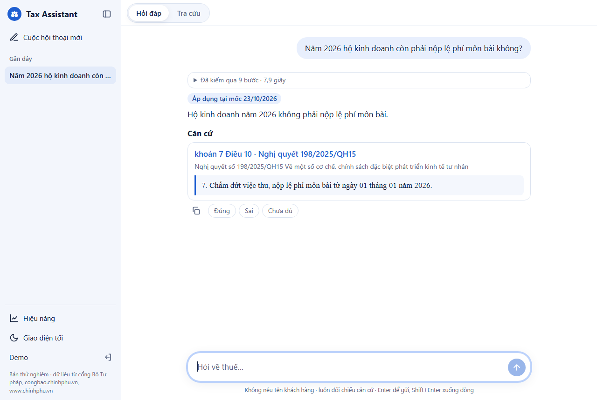
  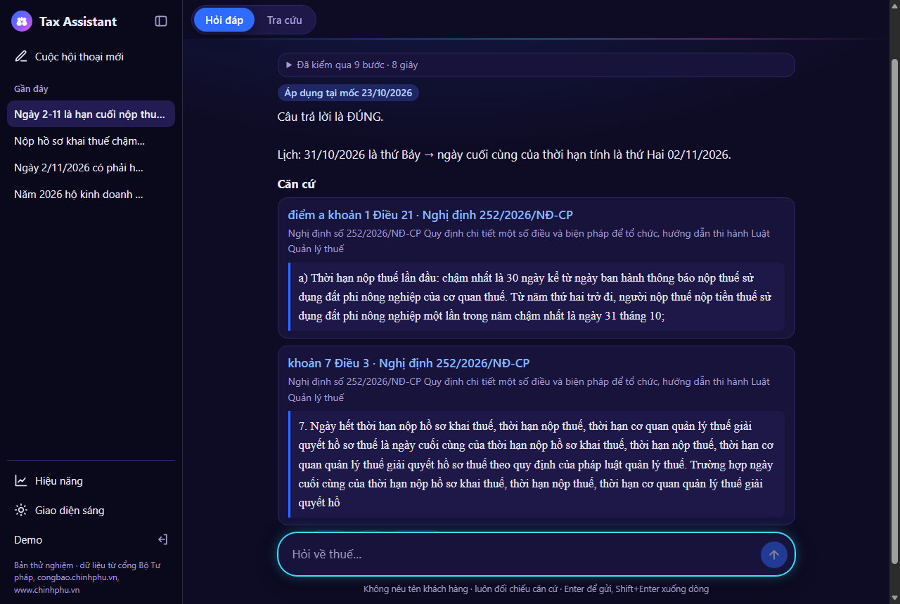
</p>

---

## Contents

- [What it does](#what-it-does) — three real questions
- [Highlights](#highlights)
- [System overview](#system-overview)
- [Data](#data) — sources, pipeline, quality layers, data model
- [AI](#ai) — answer graph, retrieval, models, guardrails, evaluation
- [Software](#software) — runtime, web app, tech stack
- [Getting started](#getting-started)
- [Accounts and remote access](#accounts-and-remote-access)
- [Known limitations](#known-limitations)
- [Repository layout](#repository-layout)
- [Roadmap](#roadmap)
- [Documentation](#documentation)

---

## What it does

The first user, a practising accountant, asked the first two questions below. The third is from the evaluation set. All three were answered wrongly at first. Each failure led to a fix in the data or the code, not in the prompt.

| Question (Vietnamese, as asked) | First answer | Why it failed | Fix |
|---|---|---|---|
| *"2026 còn phải nộp thuế môn bài ko"* (is the business licence fee still due in 2026?) | Cited a "Law on Licence Tax" that does not exist | Resolution 198/2025/QH15, which abolished the fee from 1 Jan 2026, was not in the corpus, and the collector skipped fee and land documents | Wider collection filter (+166 documents); a new **`cham_dut` (ceased)** relation read from *"Chấm dứt việc thu, nộp lệ phí môn bài từ ngày 01 tháng 01 năm 2026"*; the declaring clause is pulled into context automatically |
| *"Ngày 2-11 là hạn cuối nộp thuế sử dụng đất phi nông nghiệp"* (is 2 November the deadline for non-agricultural land tax?) | "No legal basis found" | The law says *31 October*. In 2026 that is a Saturday, so the deadline moves to Monday, and a 4B model does not work out weekdays reliably | **Deterministic deadline rule**: when a question is about a deadline, code adds the holiday rule (Decree 252/2026, Art. 3(7)) and a computed calendar line. A date or weekday the model writes in the conclusion must match that line |
| *"Nộp hồ sơ khai thuế chậm 75 ngày thì bị phạt bao nhiêu?"* (filed 75 days late: what is the fine?) | 5–8 million (the 31–60-day bracket) | The 61–90-day clause ranked 5th, but only 4 articles were sent to the model | 5 articles sent, to match the recall@5 the search is measured on. The conclusion is now 8–15 million |

<p align="center">
  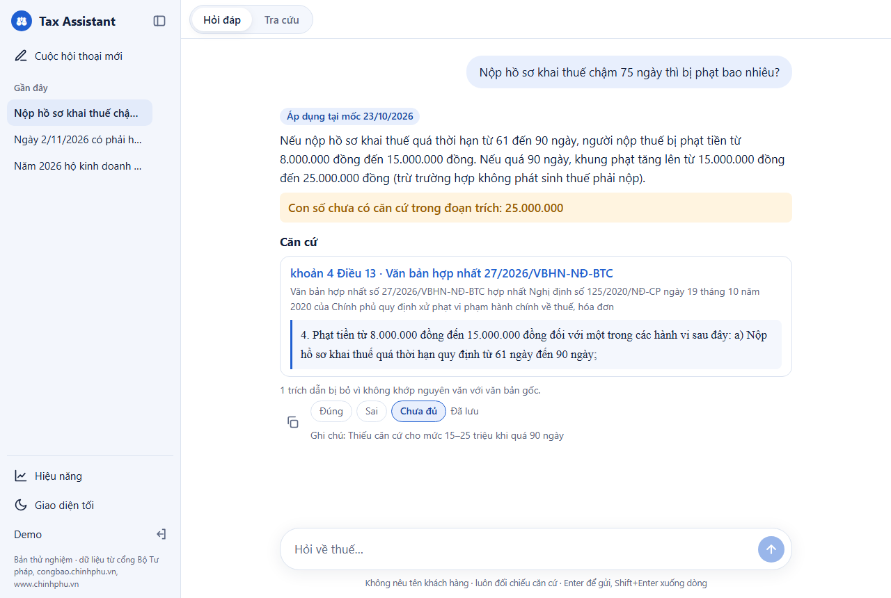
</p>

The screenshot shows the guardrails at work on the third question. The model also stated a fine for *more than* 90 days (15–25 million), which none of its verified quotes supports, so **25.000.000** is flagged in amber. One quote did not match the stored text and was dropped ("1 trích dẫn bị bỏ…"). The rating row is shown with *Chưa đủ* (incomplete) and a note, clicked here from a demo account. Ratings and notes are stored for evaluation, and the note box closes on save.

---

## Highlights

| | |
|---|---|
| **Verified citations** | A quote must match the stored article text character for character (whitespace aside). A quote that does not match is dropped, never shown. |
| **Point-in-time answers** | Each answer is resolved at an as-of date read from the question by rules ("năm 2025", "1/7/2026", "hiện nay"; questions about the current year use today). Laws repealed by a newer law, and charges that have ceased, are labelled with the exact clause that ended them. |
| **Hybrid retrieval** | PostgreSQL full-text search and BGE-M3 vectors (pgvector), fused with reciprocal rank fusion and filtered by validity at the as-of date. |
| **Deterministic where it matters** | As-of date, cross-references, deadline calendar, numbers and dates in the conclusion: all checked by code, not by the model. |
| **Multi-part questions** | Long analytical questions are split into focused sub-queries. Each is retrieved separately and answered point by point. |
| **Guardrails** | Verbatim quotes, number and date check, entailment score (multilingual NLI), OCR text never quoted, quarantine for documents that fail data-quality checks. |
| **Streaming UI** | Answers stream token by token, marked *"not yet verified"* until the checks finish and the verified version replaces the draft. |
| **Training data, collected safely** | The exact request and raw output of every model call are stored, together with the asker's rating. Only answers rated correct can become training targets. |
| **Fully local** | llama.cpp for generation and embeddings, ONNX Runtime for NLI. No external API at runtime. |

---

## System overview

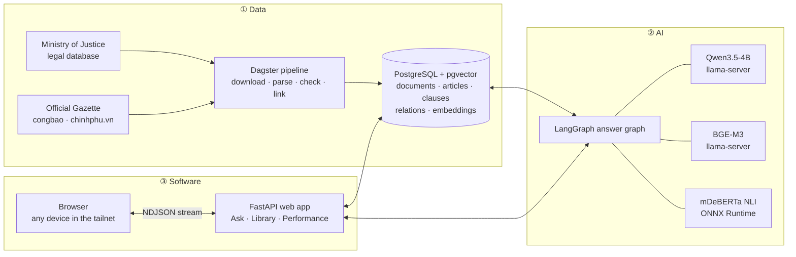

---

## Data

### Sources and compliance

No source in this domain publishes an explicit reuse licence. The project only uses publicly available data and collects it without breaking any published rule: `robots.txt` is honoured per host, every request is rate-limited, CAPTCHA-protected search is never automated, and the UI names its sources.

| Source | Used for |
|---|---|
| Ministry of Justice legal database (vbpl.vn, JSON API) | Full text, validity status, article markup, attachments |
| Official Gazette (congbao.chinhphu.vn), chinhphu.vn | Fallback text and discovery of new documents |

**Scope.** Taxes, invoices, tax administration and penalties, plus the charges an accountant meets alongside them: the business licence fee, registration fees, fees and charges, land-use levy, land and water-surface rent. A survey of all 57,788 central documents on the portal found that whole groups of fee and land documents were being missed, because their titles do not contain the word "thuế" (tax). The collector now matches them by URL and title.

### Pipeline

The pipeline is a set of [Dagster](https://dagster.io) assets with data-quality checks. It runs weekly, and each stage reports per-document failures without stopping the run.

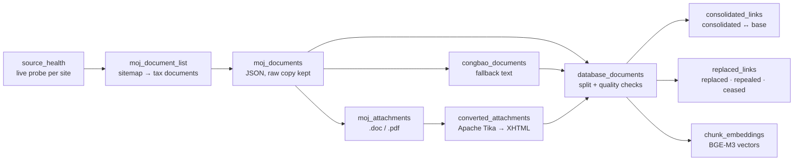

**Parsing.** HTML and converted attachments are split into *Article → clause → point* with character spans, so a citation can be labelled "point a, clause 4, Article 13". Documents without articles fall back to Roman-numbered sections, then numbered sections, then fixed-length passages. Legacy TCVN3-encoded text is converted to Unicode. Text from PDFs is marked as OCR: it is searchable but never quoted.

**Relations rebuilt from the text.** The source API returns no amendment graph, so relations are reconstructed from the documents themselves:

| Relation | Read from | Count |
|---|---|---|
| consolidated → base, amending → base | preamble of consolidated documents | 70 · 409 |
| replaced / repealed | effect articles: *"Luật Quản lý thuế số 38/2019/QH14 … hết hiệu lực kể từ ngày Luật này có hiệu lực"*, *"Nghị định này thay thế: a) …"* | 132 · 37 |
| ceased charge | *"Chấm dứt việc thu, nộp lệ phí môn bài từ ngày 01 tháng 01 năm 2026"*. No document number is given, so the targets are the earlier documents named after that charge. | 5 |

<p align="center">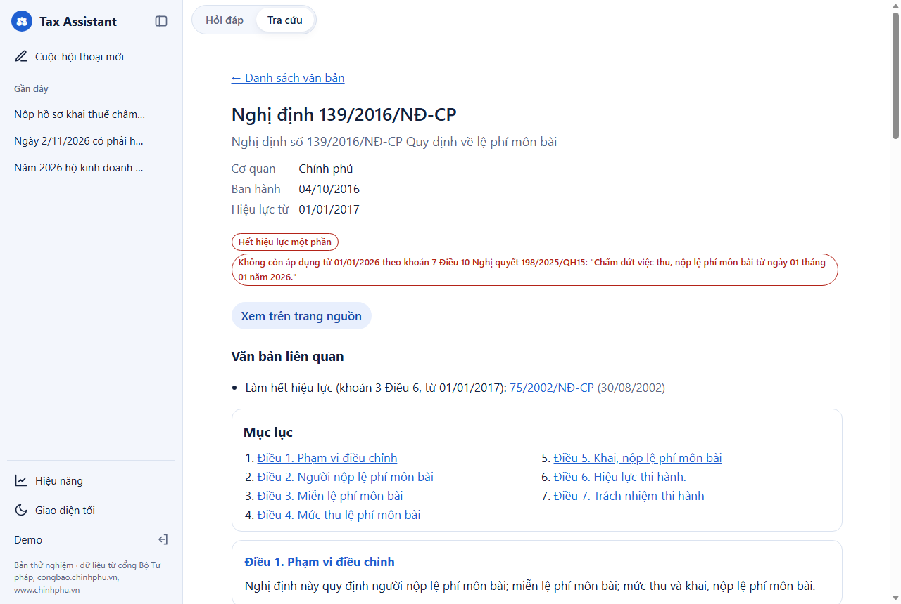</p>

### Four layers that keep the data clean

| Layer | What it does |
|---|---|
| 1. Standard tools for file formats | Apache Tika reads Word, RTF and PDF; there are no hand-written format parsers. |
| 2. Invariant checks + quarantine | Every document is checked for encoding, heading order, coverage and passage length. A document that fails a hard check is **quarantined**: searchable, never quoted, and listed for manual review (84 at present). |
| 3. Golden cases | Every real defect found becomes a fixed regression case, run on the real document (16/16 pass). |
| 4. Markup-learned structure | Where the portal provides article markup, it is the ground truth for the splitter. |

### Data model

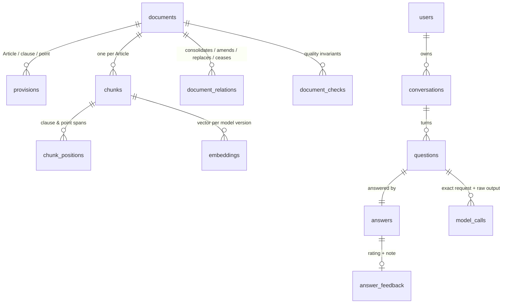

**Current corpus:**
- 3,096 tax documents, 131 of them consolidated texts
- 95,301 articles, clauses and points
- 18,688 searchable passages, all embedded

---

## AI

### Answer graph

The answer graph is a fixed [LangGraph](https://langchain-ai.github.io/langgraph/) `StateGraph`, not an agent. That keeps latency predictable, makes sure the citation check always runs, and lets every failure be traced to one step. A Postgres checkpointer keeps multi-turn conversations.

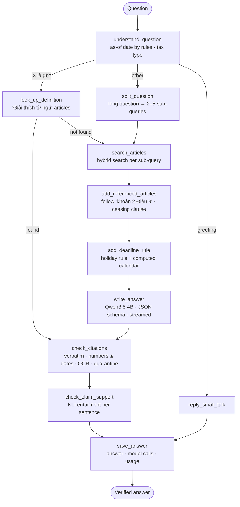

Administrators can open every answer's steps: time per step and the state each step produced.

<p align="center">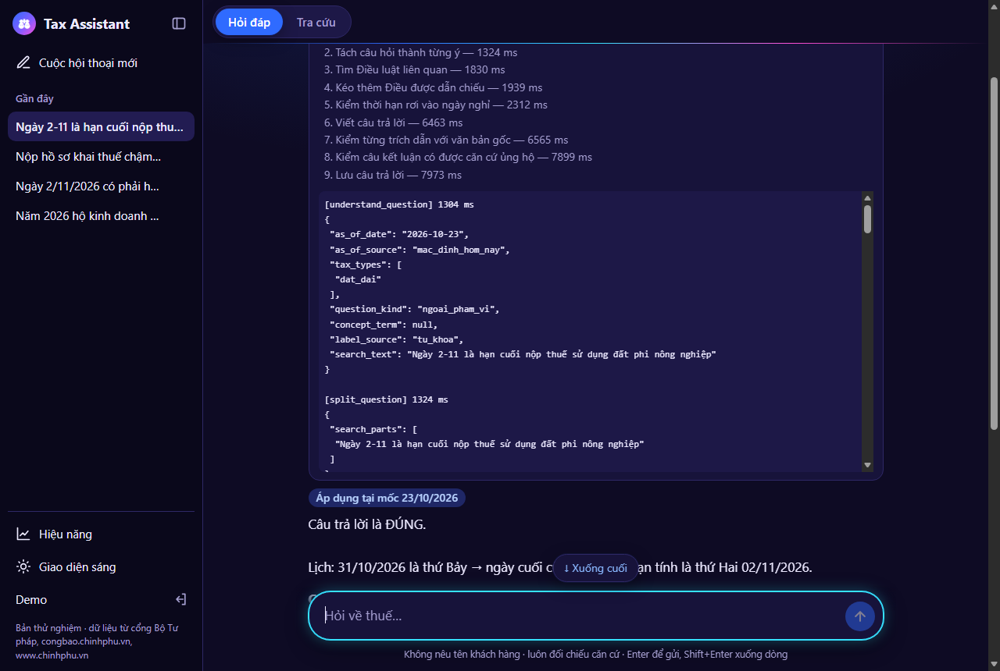</p>

### Retrieval

1. **Keyword**: PostgreSQL full-text search on accent-stripped text (`unaccent`), with a length-normalised rank and a boost for matching article titles.
2. **Semantic**: BGE-M3 vectors with exact cosine search in pgvector, so filters never cause missed results.
3. **Fusion**: reciprocal rank fusion (k = 60), weighted by legal authority (laws and consolidated texts above decrees, guidance letters last). The top 5 articles go to the model.
4. **Validity at the as-of date**: documents not yet in force, or already expired, are filtered out. A document titled for one year only ("…trong năm 2025") counts as expired after that year when the portal gives no end date. Base laws are hidden when a consolidated version exists. Repealed laws, ceased charges and old documents with unreliable status are ranked last and labelled.
5. **Context**: each passage is embedded together with its document type, number, title and article heading (contextual retrieval).

### Models

| Role | Model | Runtime | Licence |
|---|---|---|---|
| Answer generation, question splitting | Qwen3.5-4B, Q4_K_M | llama.cpp `llama-server`, GPU | Apache-2.0 |
| Embeddings | BGE-M3, f16 GGUF (converted locally from the BAAI weights) | second `llama-server`, GPU | MIT |
| Entailment guardrail | mDeBERTa-v3-base-xnli-multilingual-nli-2mil7, ONNX float32 | ONNX Runtime, CPU | MIT |

### Guardrails

| | Check | On failure |
|---|---|---|
| a | Every quote matches the stored text verbatim | Quote dropped |
| b | The quote belongs to a passage retrieved for this question (a mis-numbered passage is re-attributed only when the text matches exactly one other passage) | Quote dropped |
| c | Every number in the conclusion appears in a verified quote (except numbers from the question, the as-of date and citation labels). Full dates and weekday claims are checked as whole dates against quotes and the computed calendar. | Number flagged |
| d | No passage retrieved → no model call | "No legal basis found" |
| e | OCR text is never quoted | Document number + link only |
| f | Quarantined documents are never quoted | Document number + link only |
| g | Each conclusion sentence is entailed by the cited clause (AlignScore-style, NLI) | Scored and logged; warnings stay hidden until the threshold is calibrated |

### Evaluation

Search is measured on 22 questions with labelled correct articles: 20 written to match the user's style, plus 2 of her real questions (`python -m app.answer.measure_search`, 23 Oct 2026):

| Method | recall@5 | MRR@10 | recall@20 |
|---|---|---|---|
| Keyword | 0.36 | 0.30 | 0.45 |
| Semantic (BGE-M3) | 0.91 | 0.79 | 0.91 |
| **Hybrid (RRF)** | **0.91** | 0.68 | 0.91 |

recall@5 equals recall@20, so a reranker would not recover any missed article on this set, and none is used yet. Hybrid ranks the right article lower than semantic search alone (MRR 0.68 vs 0.79): the user's real questions find the right article at rank 4–5.

Other measurements:
- **Cross-references**: 98% of in-document references resolve to the target article.
- **NLI on ONNX float32**: scores identical to PyTorch on 51 real pairs. int8 quantisation was rejected because it flips pass/fail on 17–35 of the 51 pairs.
- **Latency** on the laptop: about 8 s for a typical question (first streamed text after 4–5 s), and 60–90 s for a five-part analytical question. Generation runs at about 68 tokens/s and prompt reading at about 2,450 tokens/s.

The evaluation method, with sources for every metric, is in [`docs/danh-gia.md`](docs/danh-gia.md).

---

## Software

### Runtime

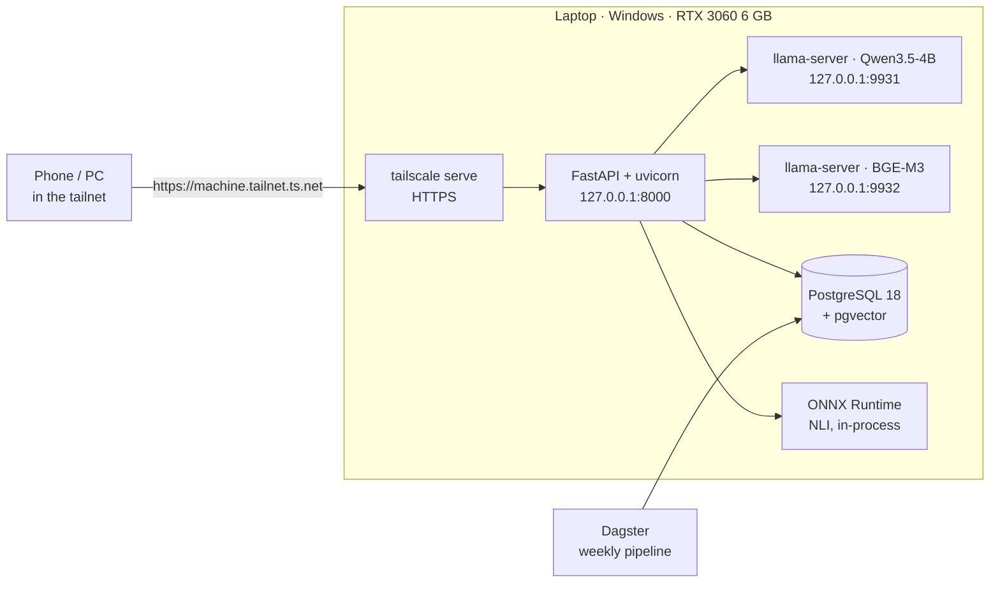

Every server listens on `127.0.0.1`. Other devices reach the web app only through `tailscale serve` (HTTPS, private tailnet).

### Web app

- **Accounts**: email and password. Registration and password reset are confirmed with a 6-digit email code. Each person sees only their own conversations.
- **Ask** (*Hỏi đáp*): ChatGPT-style layout with conversation history and streamed answers. Each answer has its as-of date, verified citations linking to the exact article, a copy button, and a *Correct / Wrong / Incomplete* rating with an optional note.
- **Library** (*Tra cứu*): browse and search documents by number, title and legal rank. Each document page shows its articles, validity labels, related documents (consolidated, amended, replaced, ceased) and the original file.
- **Performance** (*Hiệu năng*): questions asked, answer time by question type, GPU memory, model throughput, and the viewer's own recent questions.
- **Design**: light and dark themes (dark uses a synthwave palette), and it works on phones. Pages are plain HTML, CSS and JS rendered by Jinja2, with no frontend build step and no inline script, so a strict CSP is possible.

<p align="center">
  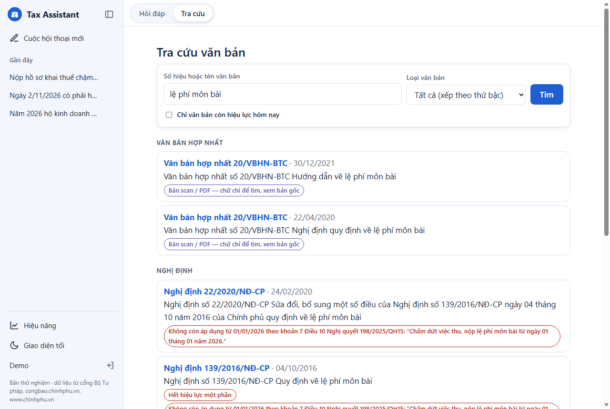
  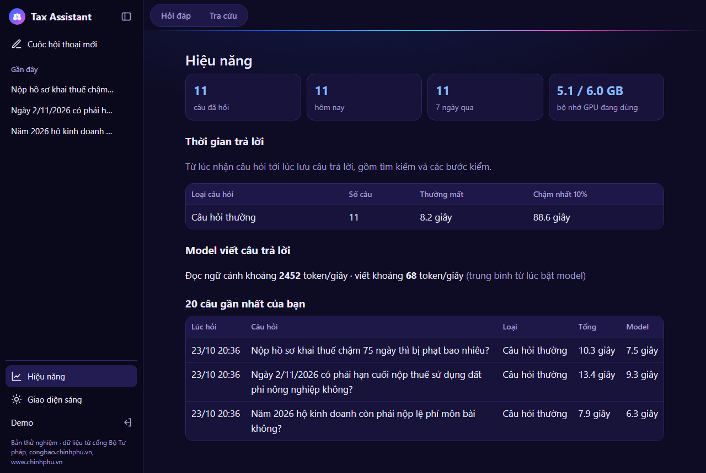
</p>
<p align="center">
  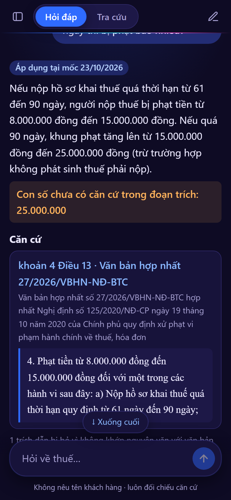
  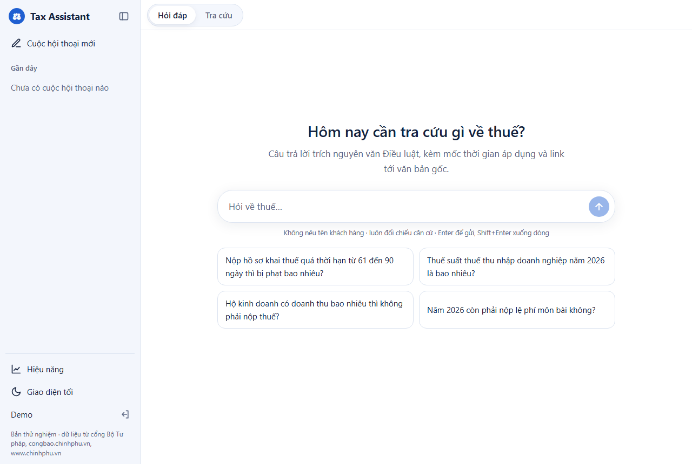
</p>

### Tech stack

Versions are the ones installed and running.

| Layer | Choice |
|---|---|
| Language | Python 3.12 |
| Web | FastAPI 0.158, uvicorn 0.54, Jinja2 3.1; vanilla JS with NDJSON streaming |
| Answer orchestration | LangGraph 1.2.16 with `langgraph-checkpoint-postgres` 3.2.0 (pinned exactly, since checkpoints are stored serialised) |
| Data orchestration | Dagster 1.13 |
| Database | PostgreSQL 18.3, pgvector 0.8.7, `unaccent`; psycopg 3.3 |
| Model serving | llama.cpp `llama-server` build b11796 (CUDA); ONNX Runtime 1.31 + `tokenizers` 0.23 (CPU) |
| HTTP client | httpx 0.28 (model servers) |
| Document conversion | Apache Tika 4.1 on Java 21, outside Python |
| Accounts | argon2-cffi 25.1, standard-library `smtplib` (Gmail SMTP), Tailscale `serve` for HTTPS |

---

## Getting started

### Prerequisites

- Python 3.12+, and Git Bash (on Windows) or a POSIX shell
- PostgreSQL 18 with `pgvector`. The Windows installer does not ship pgvector; build it with Visual Studio Build Tools (`nmake /F Makefile.win`, see the pgvector README).
- llama.cpp `llama-server` (CUDA build) with the Qwen3.5-4B GGUF and the BGE-M3 GGUF
- Java 21 and the Apache Tika 4.1 jar, needed only for the data pipeline

### Install

```bash
python -m venv .venv
source .venv/Scripts/activate            # Linux / macOS: source .venv/bin/activate
pip install -e ".[answer,ingest,pipeline]"
cp .env.example .env                     # set PGUSER / PGPASSWORD, model paths, AUTH_SECRET, SMTP_*

psql -U postgres -h 127.0.0.1 -f app/db/create_app_user.sql   # once, as superuser (run psql in cmd, not Git Bash)
python -m app.db.setup_database          # create schema, apply migrations
python -m app.db.check_database          # prints PASS

bash scripts/convert_nli_to_onnx.sh      # once: export the NLI guardrail model to ONNX
```

### Load data

```bash
bash scripts/run_embedding_server.sh     # the pipeline's last stage needs it for vectors
bash scripts/run_pipeline.sh             # whole pipeline once (about 1.5 h on a full refresh)
bash scripts/run_pipeline.sh ui          # Dagster UI + weekly schedule
python -m app.ingest.embed_chunks        # only vectors, if the embedding server was down during a run
```

### Run

Use three terminals:

```bash
bash scripts/run_model_server.sh         # answer model   → 127.0.0.1:9931
bash scripts/run_embedding_server.sh     # embeddings     → 127.0.0.1:9932 (without it: keyword search only)
bash scripts/run_web_demo.sh             # web app        → 127.0.0.1:8000, open via https://<machine>.<tailnet>.ts.net
```

`bash scripts/chat_demo.sh` runs the same graph in the terminal and prints the state after every step.

### Checks

```bash
python -m app.db.check_database              # schema, constraints, migrations
python -m app.ingest.check_golden_cases      # regression cases on real documents
python -m app.answer.measure_search          # recall@5 / MRR@10 per search method
python -m app.<package>.<module> --check     # per-module self-checks (no network, no model)
```

---

## Accounts and remote access

Every server listens on `127.0.0.1`. Other devices reach the web app through **Tailscale**: `tailscale serve` publishes it to the private tailnet over HTTPS. Nothing is exposed to the internet, and no port is opened on the router.

<p align="center">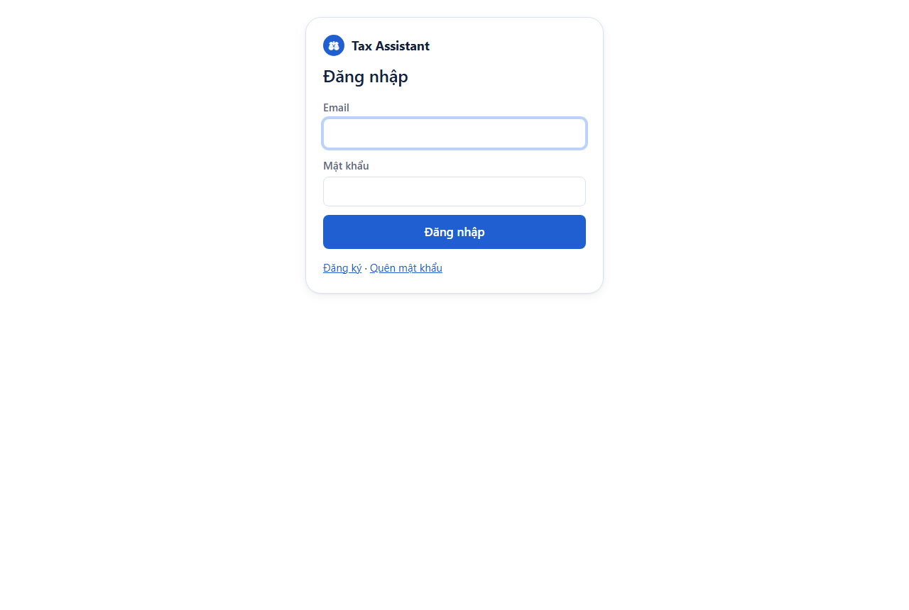</p>

1. **Install Tailscale** on the laptop and on each phone or PC that should have access, and sign in to the same tailnet. Another person's device can be added by [sharing the laptop](https://tailscale.com/kb/1084/sharing) with their Tailscale account. Enable **HTTPS certificates** in the Tailscale admin console (DNS page); `tailscale serve` asks for this on first use.
2. **Publish the web app** once (the setting survives restarts):
   ```bash
   tailscale serve --bg 8000
   ```
   This prints `https://<machine>.<tailnet>.ts.net`. Put that address in `.env` as `WEB_PUBLIC_ORIGIN`.
3. **Set up email codes** in `.env`:
   - `AUTH_SECRET`: generate it with `python -c "import secrets; print(secrets.token_hex(32))"`.
   - `SMTP_USER` and `SMTP_PASSWORD`: a Gmail account with 2-Step Verification and an [App Password](https://support.google.com/mail/answer/185833).
4. **Start the three servers** (see [Run](#run)) and open the `ts.net` address on any device in the tailnet, the laptop included. The session cookie is `Secure`, so plain `http://<LAN-IP>` cannot sign in.
5. **Register** with an email and the 6-digit code sent to it. Manage accounts from the laptop:
   ```bash
   python -m app.web.manage_users                              # accounts, conversations without an owner
   python -m app.web.manage_users --quan-tri <email> bat       # admin: sees the per-step debug panel
   python -m app.web.manage_users --huan-luyen <email> bat     # questions may be used for fine-tuning / evaluation
   python -m app.web.manage_users --khoa <email> bat           # lock an account and end its sessions
   python -m app.web.manage_users --nhan-hoi-thoai-cu <email>  # assign conversations from before accounts existed
   ```

**Security model** (based on the OWASP cheat sheets for password storage, sessions, forgot-password and CSRF):

| Part | How |
|---|---|
| Passwords | Argon2id (`argon2-cffi` defaults: RFC 9106 low-memory profile), 12–128 characters, rehashed when parameters change |
| Login | 5 failures per email in 15 minutes lock that email for 15 minutes. Unknown emails take the same time (dummy hash) and get the same message. |
| Sessions | 256-bit random token, of which only the SHA-256 is stored. A new token on every login. Expiry after 7 days idle or 30 days in total. Logout and password reset delete sessions on the server. |
| Cookie | `__Host-phien; Secure; HttpOnly; SameSite=Lax; Path=/` |
| CSRF | `Sec-Fetch-Site` must be same-origin (fallback: `Origin` must match `WEB_PUBLIC_ORIGIN`), plus a per-session token in every form and `fetch` |
| Email codes | 6 digits, valid 10 minutes, single use, 5 wrong tries. Only an HMAC is stored. Sending is limited to once per 60 s, 5 per email per hour, 30 per hour overall. The response is identical whether or not the email exists. |
| Data access | One middleware denies by default. Every query on user data filters by owner in SQL. SQL is parameterised everywhere. |
| Headers | CSP `default-src 'self'` with no inline script, `frame-ancestors 'none'`, `nosniff`, `Referrer-Policy: same-origin` |

**History for fine-tuning and evaluation.**
- Each answer stores the exact request sent to the model and its raw output (`model_calls`).
- The person who asked can rate it with a note (`answer_feedback`).
- Only accounts with `allow_training` contribute.
- A model answer becomes a training target only when rated correct. Wrong or incomplete answers go to evaluation, or are corrected by hand first.
- The evaluation split is by conversation and stays fixed.
- Deleting a conversation in the UI only hides it.

---

## Known limitations

These are cases found by testing on the real laptop, not hypothetical ones:

- **Retrieval depends on phrasing.** The user's wording *"Ngày 2-11 là hạn cuối…"* is answered correctly. The rephrased *"Ngày 2/11/2026 có phải hạn cuối…"* does not retrieve Decree 252/2026, Art. 21, so the answer quotes a filing deadline instead of the payment deadline and concludes wrongly. The citations are genuine; the conclusion is not. This is the main open problem.
- **Answers can go beyond their quotes.** The guardrails flag unsupported numbers, but they do not remove the sentence.
- **Lunar holidays** (Tết, Hùng Kings' day) and substitute days off are not in the deadline calendar yet. Only weekends and the four fixed solar holidays are.
- **The entailment guardrail runs in shadow mode.** Scores are logged, but the threshold has not been calibrated, so no warning is shown.
- **The question-type label** can be wrong when the model assigns it. It is only stored for statistics and does not change the answer path.

---

## Repository layout

```
app/
  config.py                     settings from .env
  db/                           schema migrations, setup and integrity checks
  ingest/                       data pipeline stages
    download_moj_documents.py     sitemap → JSON + attachments (raw copies kept)
    download_from_congbao.py      fallback source
    discover_from_other_sources.py  new documents from the Gazette / chinhphu.vn
    check_sources.py              live health probe per source
    read_attachments.py           Apache Tika → text; TCVN3 → Unicode
    split_articles.py             text → article / clause / point with spans
    save_to_database.py           load documents, provisions, chunks
    check_document_quality.py     invariant checks, quarantine, review queue
    check_golden_cases.py         regression cases on real documents
    link_consolidated_documents.py  consolidated / amending → base relations
    link_replaced_documents.py    replaced / repealed / ceased relations from the text
    embed_chunks.py               BGE-M3 vectors with document context
  pipeline/definitions.py       Dagster assets, checks, weekly schedule
  answer/                       answer graph
    answer_graph.py               LangGraph wiring, state, saving the official record
    understand_question.py        as-of date (rules), tax type, question kind
    answer_simple_questions.py    greetings, definition look-up
    split_question.py             multi-part question → sub-queries
    search_articles.py            hybrid search, validity filters, RRF
    add_referenced_articles.py    in-document cross-references, ceasing clauses
    add_deadline_rule.py          holiday rule and computed deadline calendar
    write_answer.py               generation with JSON schema, streaming
    check_citations.py            guardrails a–f
    check_claim_support.py        guardrail g (NLI, ONNX Runtime)
    call_local_model.py           the only place that calls a model
    measure_search.py             retrieval evaluation
  web/                          FastAPI app, templates, static assets
    server.py                     routes; login + CSRF middleware; security headers
    authenticate_users.py         passwords (Argon2id), sessions, login lockout
    send_email_codes.py           one-time email codes for registration and password reset
    manage_conversations.py       per-owner conversations, hide, answer ratings
    manage_users.py               account administration from the laptop
    read_library.py               Library pages, validity labels, per-owner history
    read_performance.py           Performance page
scripts/                        run model servers, web app, pipeline; ONNX export
docs/                           design documents (Vietnamese)
```

---

## Roadmap

- [x] Data pipeline: 3,096 documents, quality layers, weekly schedule
- [x] Point-in-time validity: consolidated versions, replaced and repealed laws, ceased charges, year-only documents
- [x] Hybrid retrieval with BGE-M3, cross-reference expansion, multi-part questions
- [x] Answer generation with verified citations, number and date check, deadline calendar, NLI guardrail
- [x] Web app: Ask, Library, Performance; streaming; light and dark themes; phones
- [x] Accounts with email codes, per-person history, ratings with notes; access through Tailscale
- [ ] Retrieval that is robust to rephrasing (the "2/11/2026" case above), measured on more of the user's real questions
- [ ] Evaluation set built from the user's rated questions; calibrate the NLI threshold
- [ ] Lunar holidays and substitute days off in the deadline calendar
- [ ] Reviewed procedures (checklists) for common case types, such as "expenses missing invoices"
- [ ] Recent guidance letters (công văn)

---

## Documentation

The design documents are in [`docs/`](docs/), in Vietnamese:

| File | Contents |
|---|---|
| [project-overview.md](docs/project-overview.md) | Product, scope, success criteria |
| [architecture.md](docs/architecture.md) | Stack, module boundaries, storage, access control, invariants |
| [danh-gia.md](docs/danh-gia.md) | Guardrails and evaluation for every model stage, with sources |
| [pipeline-du-lieu.md](docs/pipeline-du-lieu.md) | Data pipeline stages, checks, how to run and debug |
| [nguon-du-lieu.md](docs/nguon-du-lieu.md) | Data-source research and scope survey |
| [thu-bac-van-ban.md](docs/thu-bac-van-ban.md) | Legal hierarchy and conflict rules |
| [thuat-ngu.md](docs/thuat-ngu.md) | Glossary of legal terms |
| [ui-context.md](docs/ui-context.md) | UI layout, colours, components |
| [code-standards.md](docs/code-standards.md) | Coding conventions |
| [ai-workflow-rules.md](docs/ai-workflow-rules.md) | How AI assistants work on this repository |
| [ke-hoach.md](docs/ke-hoach.md) | Plan, with a "done when" for each step |
| [progress-tracker.md](docs/progress-tracker.md) | Status, decisions, open questions |

---

*This tool assists research and does not give legal advice. Always check the cited provisions before relying on an answer.*
